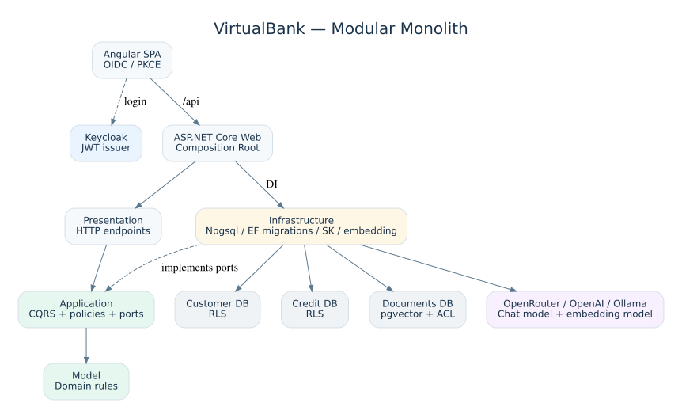
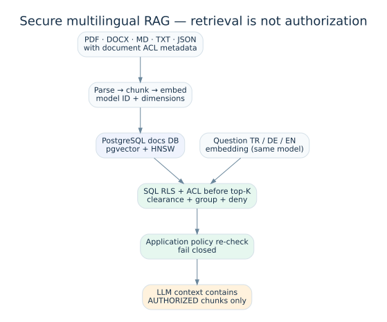

# VirtualBank — Security-Aware AI Banking Assistant

**A cross-platform .NET 10 + Angular engineering reference application** demonstrating Clean Architecture, a modular monolith, Keycloak identity, RBAC/ABAC, PostgreSQL Row-Level Security, EF Core Code First, Semantic Kernel tool calling and **permission-aware multilingual RAG** with pgvector.

> **Reference implementation, NOT a real bank.** All organizations, customers, accounts, IBANs, payments, policies, salaries and dates are deliberately synthetic. This revision was built, unit/architecture-tested and exercised end-to-end locally with Docker Compose (Keycloak, PostgreSQL + pgvector, OpenRouter and Ollama). The Playwright e2e suite, ARM64 images and production-like deployments were **not** run; a checked-in test is not proof that it passes in your environment. See [validation status](docs/VALIDATION_STATUS.md) and the [publication gate](docs/PUBLICATION_QUALITY_GATE.md).



### Contents

1. [Why VirtualBank?](#why-virtualbank) · [Purpose and scope](#purpose-and-scope-what-this-project-is-not)
2. [Features and sample user journeys](#features-and-sample-user-journeys)
3. [Stack and architecture](#stack-and-architecture)
4. [Authentication and security boundaries](#authentication-and-security-boundaries)
5. [AI Agent and multilingual RAG](#ai-agent-and-multilingual-rag)
6. [Get started: Windows, Linux and macOS](#get-started-windows-linux-and-macos)
7. [Switch Ollama / OpenRouter / OpenAI](#switch-ollama--openrouter--openai)
8. [Demo users and questions](#demo-users-and-questions)
9. [Tests, quality evidence and CI](#tests-quality-evidence-and-ci)
10. [Troubleshooting and safety](#troubleshooting-and-safety)
11. [Project layout and further reading](#project-layout-and-further-reading)
12. [Roadmap and limitations](#roadmap-and-limitations)

## Why VirtualBank?

A banking assistant should do more than answer a fixed set of canned phrases. Users may ask *"Jana'nın toplam bakiyesi ne?"*, *"Wie viel Geld hat Jana?"*, or *"Show the balances of customers I am allowed to access"*. A real LLM is allowed to infer intent and request the appropriate **C# use case** — reads directly, changes only as a confirmation card that the user confirms. It is **not** allowed to infer authorization, fabricate IBANs, mix EUR/USD/TRY without an FX rate or use an untrusted document as an instruction.

VirtualBank explores the separation between **flexible natural-language interpretation** and **deterministic enterprise controls**. It uses actual role and resource checks, independent Application policies and database RLS. A Customer Advisor and a Credit Analyst asking the same question may legitimately receive different answers because they see different data. An administrative title does not override this boundary.

The project is organized for studying and explaining real design tradeoffs, not for replicating regulated production payment services. It is a *layered modular monolith*, not a fabricated network of microservices.

### Purpose and scope (what this project is not)

**Purpose.** VirtualBank is a teaching and portfolio reference for one question: *how can an AI assistant act on behalf of a user inside a regulated domain without ever exceeding that user's rights?* It shows the full chain — identity (Keycloak) → permissions → application policies → PostgreSQL row-level security → tool calling and RAG → human confirmation of every change — and lets you watch different roles get different answers to the same question.

**It is not a banking system.** The banking functions exist to make authorization realistic, not to be complete or correct as finance software:

- No real money, payment rails, SEPA/SWIFT connectivity, clearing or settlement. A "transfer" is two database rows.
- No scheduler for planned payments, no interest, fees, FX conversion, statements, cards, loans servicing or collections.
- No KYC/AML, fraud detection, sanctions screening, regulatory reporting, accounting ledger or reconciliation.
- No production hardening: demo credentials, in-memory confirmation cards, single API instance, no HA/backup strategy.
- Certified security, compliance (PSD2, GDPR, BAIT/DORA …) or banking-grade auditability are **out of scope**.

Use it to learn and discuss patterns; do not reuse it as the basis of a financial product without a full redesign and review.

## Features and sample user journeys

| Journey | Backend capability | What it demonstrates |
|---|---|---|
| Advisor: "Listeleyeceğim müşteriler hangileri?" | `list_customers` | Branch-scoped customer authorization + RLS |
| Analyst: "Zeig mir den Kreditantrag K-100" | `get_credit_application` | Assignment-based credit access |
| Customer: "IBAN'ım nedir?" | `get_my_profile` | Verified Keycloak subject-bound self-service |
| Customer: "Meine Kontostände in EUR, USD und TRY" | `get_my_balance_summary` | Multi-currency grouping without invented FX conversion |
| Customer: "Gelecek 5 gün hangi ödemelerim var?" | `get_my_upcoming_payments` | Planned vs historical operations separated |
| Customer: "Wie hoch sind die aktuellen Kontogebühren 2026?" | `search_documents` | Public-document RAG with citations |
| Analyst: "2023 ve 2026 kredi onay politikaları farklı mı?" | `search_documents` | Temporal document disambiguation + Credit ACL |
| HR: "Welche Vertraulichkeitsregel gilt für Gehaltsbänder?" | `search_documents` | Classification 3 and HR role ACL |
| Admin: "Zeig mir alle Kundendaten" | No authorized business tool | Admin is not implicitly a banker |
| Approver: "K-100 krediyi onayla" | `approve_credit_application` prepares a card | The model proposes; only the approver's own confirmation executes (limit, four-eyes, RLS re-checked) |
| Customer: "Send 120 EUR to DE89 3704 …" | `plan_transfer` → confirmation card | Booked immediately when dated today; credited to the beneficiary if they bank here; no overdraft |
| Customer: "Apply for a 15,000 EUR car loan" | `request_credit` → card | Customer-prepared application, decided by an approver |
| Advisor: "Deposit 500 EUR cash to A-10021" | `cash_deposit` → card | Cash desk only for customers of the advisor's branch |

The assistant understands English, German and Turkish; the UI is available in English, German and Turkish (picker at the top right, browser language by default). It offers role-aware capability suggestions, response notices, tool-call information and structured authorized result tables. The document search endpoint additionally returns authorized, source-linked excerpts. **The model does not create permissions or alter a database record merely by choosing a tool:** every change is a single-use confirmation card that the same user confirms. See [Banking operations](docs/BANKING_OPERATIONS.md).

### Screenshots and demonstrations

This repository includes **real architecture diagrams**, not invented browser screenshots. For a public portfolio release, capture screenshots from a **successfully running** Angular UI: advisor customer list, customer multi-currency balances, the Assistant's tool-call trace, and a document answer with citations/denial. Never paste an actual token or secret into a screenshot. A proposed 60–90 second demo is described in [the publication gate](docs/PUBLICATION_QUALITY_GATE.md).

## Stack and architecture

| Layer / responsibility | Technology | Role |
|---|---|---|
| Web UI | Angular + TypeScript + Keycloak OIDC PKCE | Login, Customer/Credit views and Assistant |
| API host / presentation | ASP.NET Core / .NET 10 | Endpoint contracts, HTTP auth, DI composition root |
| Domain | C# domain types | Invariants and domain concepts independent of AI/DB frameworks |
| Application | CQRS handlers, ports, policies | Customer/Credit/self-service use cases, ACL evaluation, ToolPolicyGate |
| Infrastructure | Npgsql, EF Core, pgvector, Semantic Kernel | Persistence, OAuth integration, LLM and embedding adapters |
| Identity | Keycloak 26.x | JWT issuer, realm roles, groups, clearance, audience |
| Persistence | PostgreSQL 16 + pgvector | Customer, Credit and Documents DBs with RLS |
| Schema management | EF Core Code First + dedicated migrator | PK/FK/index/constraints; native RLS in versioned migration SQL |
| Local AI | Ollama `qwen3:4b-instruct` + `bge-m3` | Tool-capable chat plus 1024-dimensional multilingual embeddings |
| Optional cloud AI | OpenRouter GPT-4o or direct OpenAI | Alternative chat and embedding providers |
| Verification | xUnit, specification matrix, SQL/RLS, Bruno, Angular/Playwright, Python retrieval evaluation | Independent source and integration evidence |

### Dependency direction

```text
Angular ── HTTP/JWT ──> VirtualBank.Web (composition root)
                               │
                         Presentation
                               │
                         Application ──> Model
                               ▲
                               │
                        Infrastructure
              / Npgsql, EF Core, Keycloak,
                Semantic Kernel, embeddings /

Business modules: Customers | Credit | Assistant | Documents
Separate DBs: customer_db | credit_db | documents_db
```

The **Application layer knows no Semantic Kernel or Ollama types**. The AI adapter lives in Infrastructure. Tools call **existing authorized Application handlers**; they do not bypass policy by directly querying database tables. EF Core Code First manages schema and migrations, while selected runtime repositories deliberately use Npgsql with trusted transaction-local RLS context. That tradeoff is explained in [Architecture](docs/architecture.md).

## Authentication and security boundaries

<details>
<summary>How a real bank-data lookup is protected</summary>

```text
Keycloak login → audience/issuer/signature/expiry validation
   → PrincipalContext (verified sub, roles, groups, branch, clearance)
   → Assistant tool visibility (Hide / safe Explain mode)
   → ToolPolicyGate (permissions, risk, arguments, rate/call limits)
   → Application use case / resource policy
   → restricted database credentials + PostgreSQL FORCE RLS
   → reauthorize returned document metadata before LLM prompt
   → authorized answer + source IDs + deterministic notices
```

The web browser and LLM cannot submit trusted `app.principal_id`, `app.clearance` or `app.permissions` PostgreSQL settings. They are set by the server inside a transaction from a validated token. An LLM-selected function is a request, **not** an authorization decision.

</details>

**Document authorization requires all checks to pass:** the caller has `document.read`, the required classification fits their clearance, any branch restriction matches, at least one ACL `allow` matches, and **no matching explicit `deny`** exists. SQL RLS filters before top-K; the Application `DocumentReadPolicy` checks returned candidates again before any document text enters the model context. No model prompt can replace those checks.

[Calculated fixture visibility per persona](docs/ROLE_DOCUMENT_ACCESS.md) (static reference, not live test evidence).

**Banking operations.** Customers transfer money (SEPA and between own accounts), create standing orders and apply for credit; advisors run the branch cash desk; approvers approve or reject credits. Every change is a single-use confirmation card that the same user confirms, from a menu or from the assistant, and the database enforces ownership, limits and no overdraft again. See [Banking operations](docs/BANKING_OPERATIONS.md).

**Bank customer public documents:** `bank-customer` has `document.read` but clearance **Public (0)**. This allows public account products, fees, SEPA and FAQ pages while prohibiting internal, Credit and HR documents. By contrast, `lena.admin` has no `document.read` and cannot read even public documents. A Bank Customer's personal banking data is separately protected by subject-to-customer linkage; document visibility does not grant other customers' accounts.

**Security limitations:** the application is one process that holds credentials to multiple DBs. PostgreSQL RLS reduces mistakes and constrains ordinary queries but cannot prevent a malicious, fully compromised trusted API host from impersonating RLS context. Conversation storage is not a durable, reauthorized production history. **Authorization limits the blast radius of prompt injection; it does not prevent it.** Details: [Authorization model](docs/authorization-model.md), [Threat model](docs/threat-model.md), [Defense-in-depth diagram](docs/assets/security-rls.svg).

## AI Agent and multilingual RAG

### Why two local models?

- **`qwen3:4b-instruct`**: interprets TR/DE/EN natural language, chooses Semantic Kernel tools, and writes a concise explanation from authorized tool results.
- **`bge-m3`**: converts source chunks and a search query into **1024-dimensional semantic embeddings**. PostgreSQL pgvector searches these vectors. It is *not* another chatbot.

The same chat model can plan tool calls **and** compose RAG answers; embedding is an independent model responsibility. Normal live Customer/Credit/IBAN/payment data comes from authorized SQL-backed Application use cases, **not** from approximate vector search.



### Document corpus and quality testing

The repository ships **30 synthetic documents**: 8 PDF, 7 DOCX, 6 Markdown, 5 TXT and 4 JSON files. They span English, German and Turkish, five new three-page searchable PDFs, overlapping SEPA guidance, and **archived 2023/2024 versus current 2026** credit/fee policies. Access classes cover public (0), internal (1), confidential (2) and strictly confidential (3), plus branch/role/group ACL, explicit denial and a deliberate prompt-injection fixture (`DOC-112`). The source-of-truth list is [`sample-docs/manifest.json`](sample-docs/manifest.json). Runtime ACL edits are authoritative in the DB after ingestion, rather than in the manifest.

The `tests/evaluation/rag_golden.json` suite contains **42 labeled cases, 14 per language**, including cross-lingual searches, near-duplicate policy versions and customer/public-only access. `tools/evaluate_rag.py` calculates **Hit@5, MRR@5, known-ID coverage@5, temporal Top-1**, and checks returned document IDs against a separate fixture authorization oracle. Latest measured result (OpenRouter embeddings, fresh install): **Hit@5 85.7 %, 0 unauthorized hits**. [Evaluation methodology](docs/RAG_EVALUATION.md).

A top cosine match is not automatically the correct answer; a similarity threshold is a *retrieval heuristic*, not a permission control or a hallucination guarantee. If relevant authorized evidence cannot be found, the Assistant must say so rather than fabricate a policy.

## Get started: Windows, Linux and macOS

**One codebase, one Docker Compose topology; two small OS-specific launchers.** You do not need the .NET SDK installed to start the containerized application, only Docker/Compose and the relevant host shell and helpers. For source-only development and tests, install .NET 10 separately.

### Prerequisites

| | Windows | Linux | macOS |
|---|---|---|---|
| Container runtime | Docker Desktop with Compose | Docker Engine + Compose plugin | Docker Desktop with Compose |
| Shell | PowerShell | Bash | Bash (system default is sufficient) |
| Helpers for ingestion | PowerShell built-ins | `curl`, `jq` | `curl`, `jq` (`brew install jq` if needed) |
| Recommended resources | Allow room for Docker, ~3.7 GB local model weights **plus images/cache/runtime memory** | Same | Same |

The first run requires internet to pull images/models and enough free disk. The local model's **download size is not its memory footprint**. Apple Silicon ARM64 image support and local acceleration should be checked on the actual device; this release is not claimed ARM-certified.

**1. Clone or download** the repository and open a shell in its root (the directory containing `compose.yaml`). Replace `<REPO_URL>` with the actual GitHub URL:

```bash
git clone <REPO_URL>
cd <repo-directory>
```

**2. Start local Ollama + API + UI + seed + document ingestion (no cloud API key):**

**Windows PowerShell:**

```powershell
.\scripts\windows\start-local.ps1
# For a faster API-only diagnostic: .\scripts\windows\start-local.ps1 -SkipIndex
```

**Linux or macOS Terminal:**

```bash
bash scripts/unix/start-local.sh
# For API-only: bash scripts/unix/start-local.sh --skip-index
```

Both scripts create `.env` from `.env.example` **only when missing**, explicitly select the optional Ollama Compose `ai` profile, download `qwen3:4b-instruct` and `bge-m3`, run the one-shot EF Core migrator, start Keycloak/API/UI and index the 30 documents. They **do not** delete volumes or silently substitute `Offline` for a missing LLM.

**3. Open the UI:** [http://localhost:4200](http://localhost:4200). Keycloak is at [http://localhost:8080](http://localhost:8080) and API readiness is [http://localhost:8081/health/ready](http://localhost:8081/health/ready). The first Keycloak realm import can take some time.

**Alternative: start with OpenRouter (no local models, faster on small machines):**

```powershell
Copy-Item .env.example .env        # Linux/macOS: cp .env.example .env
# Edit .env: comment out the Ollama block, uncomment the OpenRouter block, set OPENROUTER_API_KEY
docker compose up -d --build --wait
.\scripts\windows\INDEX_DOCUMENTS_WINDOWS.ps1   # Linux/macOS: bash scripts/ai-index.sh
```

The migrator creates all schemas, RLS policies and the synthetic seed data (customers, accounts, IBANs, credit
applications, planned payments) on the first start; indexing embeds the 30 sample documents for search.

**4. Sign in** with one of the [demo users](#demo-users-and-questions) (password `VirtualBank-Dev-2026!`). The menu
shows only what the role may use; the home page lists every persona and what to expect.

**Reset to the original demo state** (deletes all project data, including your transfers and approvals, and with
`--profile ai` also the downloaded Ollama models):

```bash
docker compose --profile ai down -v
# then start again with the starter script or the OpenRouter commands above
```

For more precise prerequisites, terminal commands, expected container states, Apple Silicon notes and common errors, use the **[full cross-platform setup and troubleshooting guide](docs/LOCAL_SETUP.md)**.

## Switch Ollama / OpenRouter / OpenAI

| Mode | Chat/tool calling | Embedding | Needs API key | Ollama container |
|---|---|---|---|---|
| **Default local** | Ollama `qwen3:4b-instruct` | Ollama `bge-m3` (1024) | No | Explicitly enabled by local starter |
| OpenRouter | `openai/gpt-4o` | `openai/text-embedding-3-small` (1024) | Yes, `OPENROUTER_API_KEY` | **Not started** by normal Compose |
| Direct OpenAI | `gpt-4o` | `text-embedding-3-small` (1024) | Yes, `OPENAI_API_KEY` | **Not started** by normal Compose |
| `Offline` (test-only) | Keyword/rule-driven C# router; **no LLM** | Independent embedding provider still required for document search | No for test router | Optional |

In `.env.example`, cloud settings including `# OPENROUTER_API_KEY=` and `# OPENAI_API_KEY=` are **commented**. To switch: edit the **untracked** `.env`, comment all active Ollama provider/model/endpoint/dimensions assignments, uncomment one complete cloud block and insert your key. Never publish `.env`, tokens or server-side logs with secrets.

```bash
# Linux/macOS or PowerShell, AFTER cloud config is selected:
# Do NOT add --profile ai or COMPOSE_PROFILES=ai.
docker compose up -d --build --wait
```

Ollama is **not a dependency** of the API service. The default Compose start therefore does not download it; only local starter or explicit `--profile ai` does. If Ollama was running from an earlier test, stop it without deleting models: `docker compose --profile ai stop ollama`.

**Reindex after changing the embedding model**: equally long vectors from different model families are not interchangeable. Switching only the chat model does not require reindexing. For full examples see [Local and Cloud profiles](docs/LOCAL_AND_CLOUD_MODEL_PROFILES.md) and [Cross-platform setup](docs/LOCAL_SETUP.md).

## Demo users and questions

**Local-only demo password:** `VirtualBank-Dev-2026!` for all 14 human personas. These are NOT production credentials.
Each persona sees only the menus its permissions allow; *My access* (always visible) lists the effective permissions.

### Staff

| Login | Role (Keycloak) | Menus | Can do | Try asking the assistant |
|---|---|---|---|---|
| `anna.berater` | Customer advisor, branch STR (`customer-advisor`) | Customers, Documents, Assistant | Stuttgart customers with masked sensitive fields; **cash desk** deposits/withdrawals for her branch; internal documents. No credit access | "Müşterilerimi listele" · "Deposit 500 EUR cash to A-10021 of C-1002" |
| `mehmet.kredit` | Credit analyst (`credit-analyst`) | Customers, Credit applications, Documents, Assistant | Only applications assigned to him and their customers; **adds notes**; confidential credit policies | "Zeig mir K-100 und die Freigaberichtlinie 2026" · "Add a note to K-100: income verified" |
| `max.approver` | Credit approver, limit 50,000 EUR (`credit-approver`) | Credit applications, Documents, Assistant | **Approves or rejects** submitted applications within his limit, never one he prepared (four-eyes) | "Was unterscheidet die 2023- und 2026-Kreditrichtlinie?" · "Prepare the approval of K-100" |
| `sarah.security` | Security administrator (`security-admin`) | Document access | **Edits document ACLs** (who may read which document); cannot read document content, customers or credits | — (no assistant) |
| `sophie.hr` | HR specialist, strictly confidential clearance (`hr-specialist`) | Documents, Assistant | HR documents up to classification 3; no customers or credits | "Maaş bantlarının gizlilik kuralı nedir?" |
| `oliver.ops` | Operations operator (`operations-operator`) | Documents | Internal and confidential operations documents (runbooks, incident playbook); no customer data | — (no assistant) |
| `lena.admin` | Platform administrator (`platform-admin`) | Assistant | No business data and no documents: an admin title is not a superuser | "Welche Berechtigungen habe ich?" · "Müşteri kayıtlarını getir" (refused) |
| `tom.auditor` | Auditor (`auditor`) | My access only | Holds `audit.read` / `diagnostics.read`; no business data | — (no assistant) |

### Bank customers (branch MUC)

All six have the `bank-customer` role: **My banking** (accounts, IBANs, balances per currency, payments, SEPA
transfers, transfers between own accounts, standing orders, cancelling/pausing), **Credit applications** (apply,
follow the decision), public **Documents** and the **Assistant**. They never see another customer's data.

| Login | Customer | Accounts | Try asking |
|---|---|---|---|
| `deniz.customer` | C-2001 Deniz Kaya | A-20011 EUR, A-20012 EUR savings, A-20013 USD, A-20014 TRY | "IBAN'ım nedir?" · "A-20011 hesabımdan A-20012 hesabıma 250 EUR aktar" · "60 ay vadeli 15.000 EUR kredi başvurusu" |
| `meryem.customer` | C-2002 Meryem Demir | A-20021 EUR, A-20022 USD, A-20023 TRY | "Show my balances per currency" |
| `lucas.customer` | C-2003 Lucas Schneider | A-20031 EUR, A-20032 USD, A-20033 TRY | "Which payments are due in the next 5 days?" |
| `thomas.customer` | C-5001 Thomas Huber | A-50011 EUR, A-50012 USD, A-50013 TRY | "My balances and upcoming payments" · "Show my standing orders" |
| `elif.customer` | C-5003 Elif Yılmaz | A-50031 EUR, A-50032 USD, A-50033 TRY | "What are the current 2026 account fees?" |
| `emilia.customer` | C-5004 Emilia Fischer | A-50041 EUR, A-50042 USD, A-50043 TRY | "Send 100 EUR to Elif, IBAN DE06 1001 0010 0000 0050 03" |

The seeded IBANs are valid (mod-97), so customers can send money to each other: a transfer to another customer of this
bank is credited to them immediately; any other valid IBAN is treated as an external payment.

**Service accounts** (client credentials, not for sign-in): `svc-ingestion` indexes documents (`document.ingest`);
`svc-reporting` holds `operations.read`.

**Expected denials (try them):** Deniz asking for confidential credit policies or Thomas' accounts; Anna opening a
credit application; Lena asking for customer records; Max approving above 50,000 EUR or an application he prepared;
Anna booking cash for a customer of another branch.

### Role gaps (known, not yet implemented)

The permissions below exist in Keycloak and the authorization model, but no screen or data uses them yet. The roles
are kept so the denials and the "admin is not a superuser" rule stay visible.

| Persona | Permission without a feature | Missing piece |
|---|---|---|
| `tom.auditor` | `audit.read`, `diagnostics.read` | Immutable audit store and an auditor screen |
| `sophie.hr` | `employee.read`, `employee.salary.read` | Employee and salary-band data and screens (HR documents work) |
| `oliver.ops`, `lena.admin`, `svc-reporting` | `operations.read`, `system.configure` | Incident/batch-job data and an operations screen |

## Tests, quality evidence and CI

CI in [`.github/workflows/tests.yml`](.github/workflows/tests.yml) defines source build, unit/architecture tests, EF pending-model drift checks, fresh database RLS tests, real Keycloak claims, Bruno and Playwright. **The workflow definition is not proof that CI passed for this commit.**

The CI also checks Keycloak ingestion audience, HR clearance, the independent document read policy, script layout and **generates EF idempotent SQL without applying it**. The EF snapshots are generated by the real EF Core CLI and must keep passing the EF drift checks. See [EF snapshot verification and repair playbook](docs/EF_SNAPSHOT_VERIFICATION.md).

**Windows PowerShell** (requires .NET SDK + `dotnet-ef`):

```powershell
.\scripts\windows\VERIFY_PUBLICATION_WINDOWS.ps1
.\scripts\windows\INDEX_DOCUMENTS_WINDOWS.ps1
python .\tools\evaluate_rag.py --dry-run
python .\tools\evaluate_rag.py --min-hit-rate 0.70
```

**Linux/macOS** (requires .NET SDK + `dotnet-ef`, Python 3):

```bash
bash scripts/unix/verify-publication.sh
bash scripts/ai-index.sh
python3 tools/evaluate_rag.py --dry-run
python3 tools/evaluate_rag.py --min-hit-rate 0.70
```

The **dry-run validates only the labeled fixture IDs and expected ACLs**, not actual embedding quality or data leakage. The live benchmark needs seeded pgvector, a working embedding service, the API and Keycloak tokens. In addition, demonstrate at least one real LLM-generated multi-tool call and a denied write attempt. Build/tests on a developer machine and EF CLI model drift are mandatory before a GitHub release is described as verified.

## Troubleshooting and safety

- **Windows PowerShell doesn't recognize `make`**: Use the PowerShell starter; GNU Make is optional.
- **Host ports 5432 / 8081 already allocated**: Change `POSTGRES_PORT` / `API_PORT` in `.env` (e.g. 5433 / 8082); **leave internal `postgres:5432` and `api:8080` untouched**. Frontend port 4200 is fixed in demo redirect settings.
- **Keycloak says `Waiting`**: First import may take ~1 minute. Run `docker compose logs --tail=100 keycloak`, check actual health status.
- **Cloud test unexpectedly pulls Ollama**: Remove `--profile ai` and unset `COMPOSE_PROFILES=ai`; check if a previous Ollama container remains running.
- **`mode offline` appears in chat**: `.env` selects the deterministic router, not a live model. Choose Ollama/OpenRouter/OpenAI and recreate `api`.
- **Document search returns nothing**: Index 30 documents with `svc-ingestion` and correct 1024-dimensional embedding model; inspect `docs.documents`/`docs.chunks`, threshold and model ID.
- **NuGet critical advisory**: Upgrade to a fixed package; **do not disable audit** merely to force a green build.
- **EF migration refuses old schema**: Previous SQL-created DB volumes are not automatically adopted. Back up and deliberately migrate/reset disposable data; never run `docker compose down -v` on important volumes.
- **Keycloak claim or document visibility errors**: Inspect realm mapper, user clearance, role permissions, Application policy and PostgreSQL RLS. No shortcut through the UI or LLM should alter these rules.

**Stopping safely:** `docker compose --profile ai down` removes project containers and network but **preserves volumes**; `down -v` destroys project-managed database and model volumes. Never expose this demo with hard-coded credentials to a public interface.

See [the detailed troubleshooting guide](docs/LOCAL_SETUP.md#6-common-problems-and-how-to-diagnose-them) for the actual commands.

## Project layout and further reading

```text
src/VirtualBank.Model/             Domain invariants and entities
src/VirtualBank.Application/       CQRS use cases, ports, resource policies, Assistant
src/VirtualBank.Infrastructure/    Npgsql/EF schema, Keycloak, Semantic Kernel, embeddings
src/VirtualBank.Presentation/      HTTP endpoints and contracts
src/VirtualBank.Web/               API host and composition root
src/Frontend/virtual-bank-ui/      Angular UI

tools/VirtualBank.DbMigrator/      One-shot EF Core migrator
infra/postgres/init/              DB roles, bootstrapping and pgvector extension
infra/postgres/legacy/            HISTORICAL SQL schemas (not run for v4)
infra/seed/                       Canonical synthetic multi-currency fixtures
infra/keycloak/                   Keycloak realm, roles, groups and signed-claim mapping
sample-docs/                     30 multilingual, multi-format ACL-bound documents
scripts/windows/                 Native Windows local bootstrap
scripts/unix/                    Native Linux/macOS local bootstrap and source gate
tests/evaluation/                42 multilingual RAG cases
docs/                           Architecture, security, operations and setup documentation
docs/assets/                    Editable SVG/DOT diagrams used by the documentation
```

**Read the architectural reasoning:**

| Topic | Document |
|---|---|
| Architecture, layers and modules | [Architecture](docs/architecture.md) · [Design patterns](docs/design-patterns.md) · [ADRs](docs/adr/) |
| Identity, RBAC/ABAC and RLS | [Authorization model](docs/authorization-model.md) · [Security invariants](docs/security-invariants.md) · [Threat model](docs/threat-model.md) |
| Banking operations and human confirmation | [Banking operations](docs/BANKING_OPERATIONS.md) |
| Assistant and multilingual RAG | [RAG evaluation](docs/RAG_EVALUATION.md) · [Model profiles](docs/LOCAL_AND_CLOUD_MODEL_PROFILES.md) |
| Running it | [Local setup](docs/LOCAL_SETUP.md) · [Validation status](docs/VALIDATION_STATUS.md) |

An index of all documents, including historical review records, is in [docs/README.md](docs/README.md).

## Roadmap and limitations

- **Implemented:** human-confirmed changes (credit approve/reject, notes, transfers incl. internal credit to another customer, transfers between own accounts, standing orders, credit applications, branch cash desk, document ACL administration), multilingual UI (EN/DE/TR) and permission-derived menus.
- **Not implemented:** persistent permission-rechecked conversation history, durable (database-backed) confirmation cards, an immutable audit store with an auditor screen, HR and operations data (see [role gaps](#role-gaps-known-not-yet-implemented)), execution of planned payments on their due date, production secret storage, full folder ACL inheritance and robust assignment-projection revocation synchronization.
- **Not proven here:** the Playwright e2e suite, ARM64 images, load/fault-injection behaviour and production deployment. Live semantic quality depends on the chosen model.
- **Production caution:** do not send real account data to an external model or deploy the local dev realm publicly. The code is an educational **engineering reference**, not a certified banking, security or compliance system.

**License:** [MIT](LICENSE). Demo-only secrets and synthetic financial fixtures are for isolated local use.
