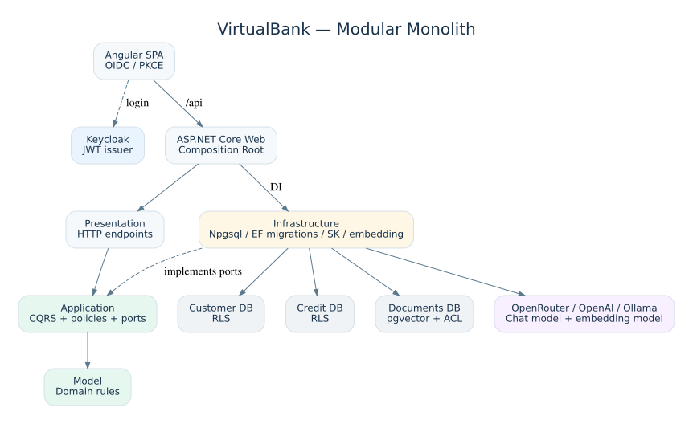
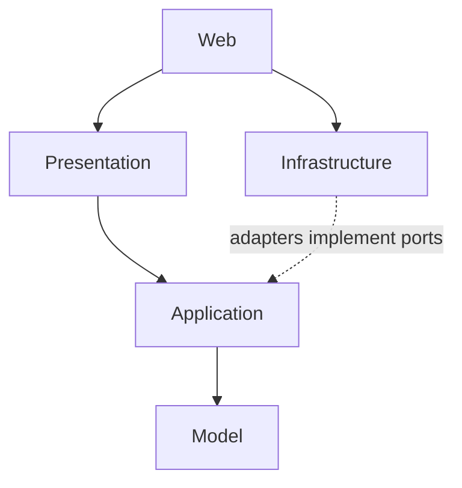
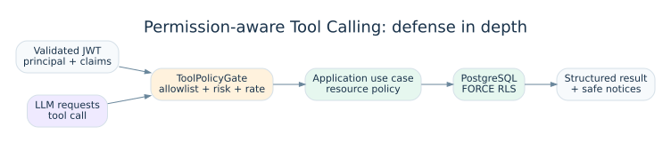
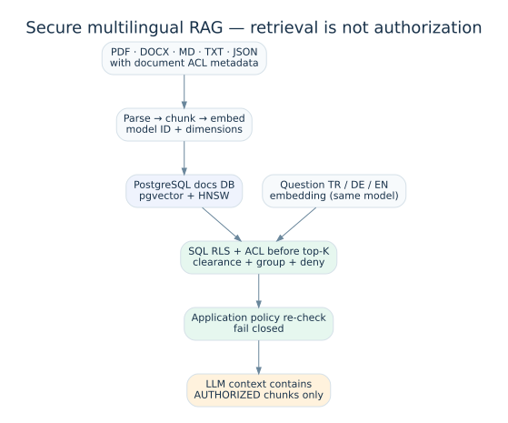
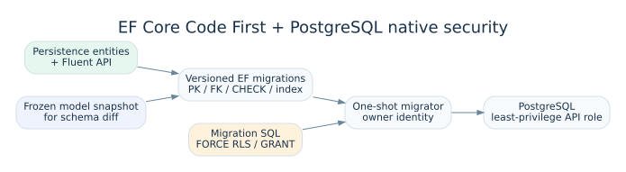

# VirtualBank architecture — source-aligned overview (v4 reference)

> **Implementation vs evidence:** This document describes the checked-in v4 source architecture. It does not claim that every integration has passed on a real developer machine. See [Publication quality gate](PUBLICATION_QUALITY_GATE.md) and [Validation status](VALIDATION_STATUS.md).

## Why a layered modular monolith?

VirtualBank is one ASP.NET Core 10 API, not separate Customer, Credit and Agent microservices. `Customers`, `Credit`, `Documents` and `Assistant` modules are grouped under the same five C# project layers. They invoke Application use cases **in-process**; the Assistant does not impersonate a downstream service over HTTP. This avoids network complexity while allowing independent policies and data ownership.

| Project | Responsibility | Can depend on |
| --- | --- | --- |
| `VirtualBank.Model` | Domain entities, value objects and domain invariants | No other VirtualBank project |
| `VirtualBank.Application` | CQRS, ports, authorization policies, tool definitions | Model |
| `VirtualBank.Infrastructure` | Npgsql under RLS, EF Core schema ownership, Keycloak, Semantic Kernel, embeddings | Application, Model |
| `VirtualBank.Presentation` | HTTP endpoints, request/response contracts and mapping | Application |
| `VirtualBank.Web` | Application host, configuration, DI composition root | Presentation, Infrastructure, Application |

## Authentication and authorization

Angular uses Keycloak OIDC Authorization Code with PKCE; `virtual-bank-ui` is the browser client. ASP.NET Core validates JWT signature/issuer/audience/expiry for `virtual-bank-api`. `PrincipalResolver` constructs the trusted `PrincipalContext`. Role-to-permission mapping is in `policies/permissions.json`.

Resource checks are in `VirtualBank.Application`. Customer rows are rechecked after the PostgreSQL RLS retrieval. Self-service identity comes only from the authenticated `sub`, not request-supplied customer IDs. Read access requires appropriate permission plus ownership/branch/assignment. Database connection logins (`customer_api`, `credit_api`, `document_api`) are restricted.

The runtime also contains **different data stores**: `customer_db`, `credit_db` and `documents_db`. A single trusted API process has their credentials, which is a threat-model limitation; RLS protects against query mistakes but is not a sandbox against total API-process compromise.

## Agent/Tool Calling

`POST /api/assistant/chat` enters `AskAssistantHandler`. The configured `IAssistantRuntime` runs either `SemanticKernelAssistantRuntime` (OpenRouter/OpenAI/Ollama) or the explicitly selected deterministic `OfflineAssistantRuntime`. The LLM may request registered read tools only; `ToolPolicyGate` validates each call. Tools invoke `ListCustomersHandler`, `GetCreditApplicationHandler`, `SummarizeCustomerBalancesHandler`, `GetMyBankingHandler` and document use cases, **never direct SQL**.

Write tools (notes, credit decisions, payments, cash desk, credit applications) only prepare a single-use confirmation card; the user confirms it through `POST /api/actions/{id}/confirm`, which re-authorizes with current data before executing (see [Banking operations](BANKING_OPERATIONS.md)). Application-generated notices and tool traces are authoritative; model prose is not a state-change confirmation.

## Documents and RAG

Synthetic PDF, DOCX, Markdown, TXT and JSON are read by `FileSystemDocumentSource`. Embeddings use independently configured OpenRouter/OpenAI/Ollama adapters; GPT-4o is the **chat** model, not the embedding model. `bge-m3` is the local default (1024 dimensions); OpenRouter/OpenAI `text-embedding-3-small` is optional. Chunk vectors use `vector(1024)` in `documents_db` and a cosine HNSW index.

The DB query applies document RLS before `topK`, including ACL/clearance/branch checks. `SecureDocumentSearch` additionally rechecks every hit through `DocumentReadPolicy`. Unauthorized chunks never belong in the model's context. Empty/weak evidence should not become invented policy statements. The configured 0.45 cosine threshold is **not** a validated universal constant; measure with `tools/evaluate_rag.py`.

## EF Core Code First and migrations

`CustomerDbContext`, `CreditDbContext`, `DocumentsDbContext` own tables, relationships, checks and indexes. Migration SQL owns PostgreSQL security functions, RLS, permissions and grants. `tools/VirtualBank.DbMigrator` uses dedicated credentials; the API never migrates schema. Static EF snapshots are historical models, independent of the current `DbContext` method. **Real EF CLI drift verification is required** before claiming migration safety.

The init bootstrap SQL only provisions roles/databases and pgvector extension. Old SQL schema/seed scripts are archived under `infra/postgres/legacy`, not run by Compose. The v4 migrator rejects an old SQL-created schema unless a deliberate migration/reset is performed after backup.

## Data fixtures and limitations

`infra/seed/fixtures.json` and `financial-fixtures.json` seed synthetic multi-currency customer/payment data. EUR, USD and TRY amounts are not combined into a fictional exchange-rate total. `infra/keycloak/realm-virtual-bank.json` defines demo identity subjects and roles. No persisted bank secrets or real customer records should be committed.

Limitations still in scope: durable cross-revocation conversation design, assignment-projection synchronization, complete folder ACL inheritance, persistent audit storage, production secret management and complete live integration evidence. These are **not implemented enterprise guarantees**. See [Quality gate](PUBLICATION_QUALITY_GATE.md).
